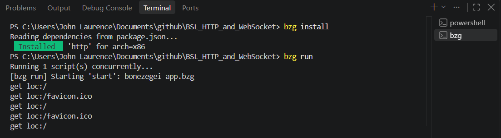
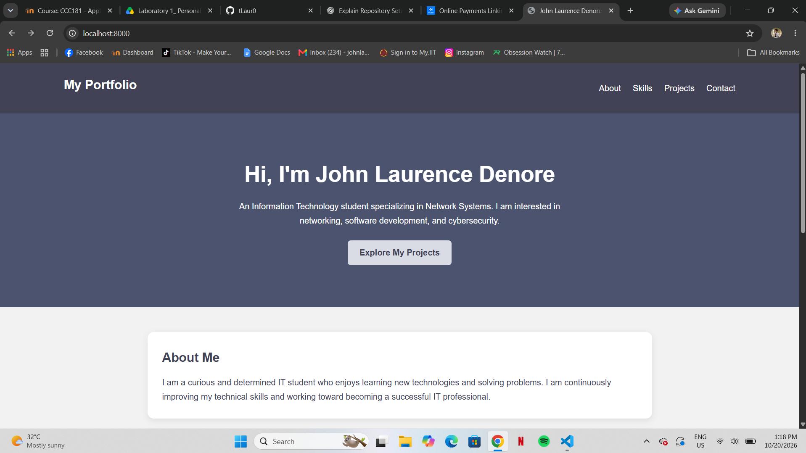

# BSL_HTTP_and_WebSocket

A simple HTTP and WebSocket server using Bonezegei Scripting Language (BSL).

## Project Description

This project is a personal portfolio website developed using HTML and CSS and served through the Bonezegei Scripting Language (BSL) HTTP server.

The portfolio introduces my background as an Information Technology student specializing in Network Systems. It presents my profile summary, technical skills, projects, and contact information in a simple and responsive layout.

## Technologies Used

- **Bonezegei Scripting Language (BSL):** Runs the HTTP server that serves the portfolio webpage.
- **HTML5:** Structures the portfolio content.
- **CSS3:** Defines the layout, styling, responsiveness, and gray color theme.
- **Git and GitHub:** Used for version control and project hosting.

## Installation and Execution

Install the required dependencies:

```bash
bzg install
```

Run the application:

```bash
bzg run
```

After the server starts, open `http://localhost:8000` in a web browser to view the portfolio.

## Execution Screenshots

### Terminal Output

This screenshot shows the terminal output when running the BSL server.



### Portfolio in Browser

This screenshot shows the personal portfolio website displayed in the browser.


